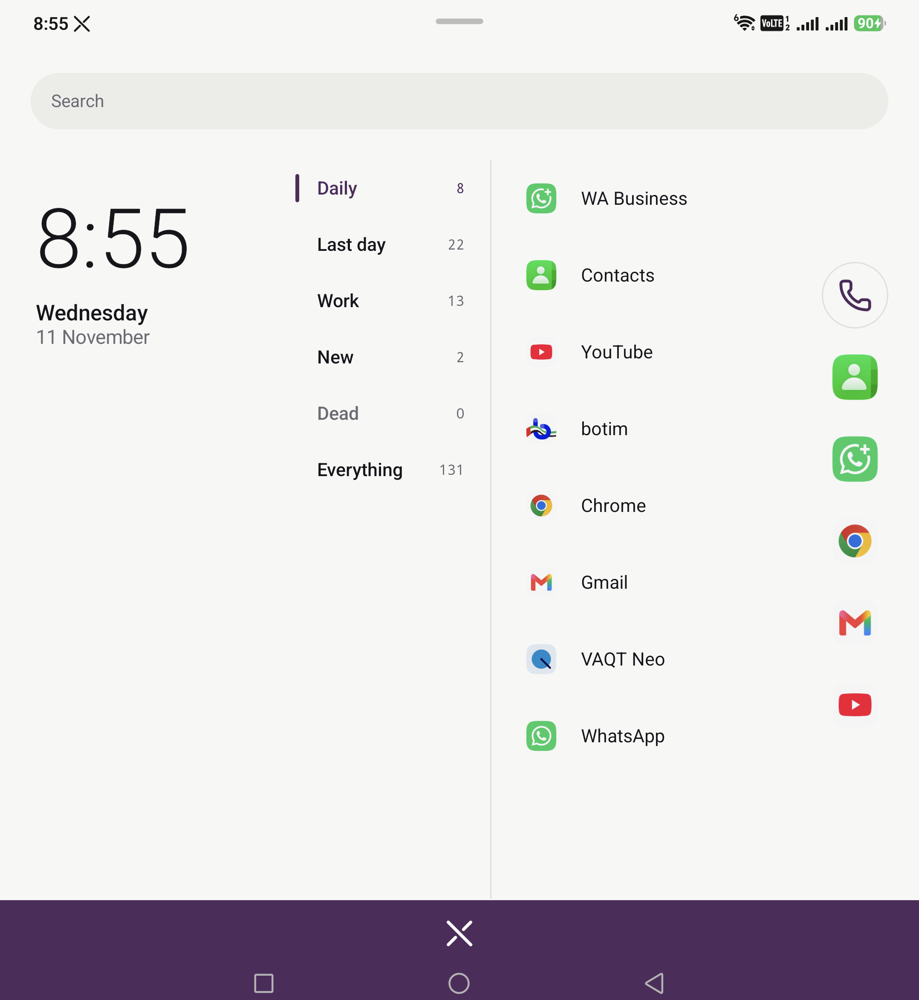

# NNCx

An Android launcher for developers, built on one idea: **the whole experience
is ranked by how often you actually use things.**

Not on the Play Store, and not going there. NNCx is a repo you clone, build
and sideload onto your own phone — which is exactly why it can hold
`WRITE_SECURE_SETTINGS` and `PACKAGE_USAGE_STATS` and do things a Store
launcher cannot.

The name is from a blog called *Non Nerdy Coder*. The `x` is the mechanic.



## The x

Normal mode looks like an ordinary phone. Paper white, 28dp corners, a clock.
Swipe up from the bottom band and every design token crosses to the other
pole at once: near-black, 3dp corners, the clock replaced by live vitals, a
blueprint grid coming up under everything.

It is one float. `xray: 0f..1f`. Every colour, corner radius, row height and
alpha in the app is a function of it, so there is no "two themes" to keep in
sync — there is one continuous surface and you choose where to stand on it.
Swipe back down to go home.

Flick the `x` mark itself sideways and it reclaims RAM.

## Build and install

Needs the JDK that ships with Android Studio (17+), Android SDK with
`compileSdk 37`, and a device on API 29+.

```bash
git clone https://github.com/xidiva999/nncx.git && cd nncx
cp nncx.properties.example nncx.local.properties   # make it yours, see below
./gradlew :app:assembleDebug
adb install -r app/build/outputs/apk/debug/app-debug.apk
```

Gradle 9.3.1, AGP 9.1.1, Kotlin 2.4.0, Compose BOM 2026.09.00.

> AGP 9 has Kotlin built in. Adding the `org.jetbrains.kotlin.android` plugin
> is a hard build error, not a warning.

### Two grants it cannot ask for itself

Both are `signature|privileged` permissions, so there is no runtime dialog.
You grant them over adb once, and they survive reboots:

```bash
adb shell appops set dev.nncx GET_USAGE_STATS allow
```

```bash
adb shell pm grant dev.nncx android.permission.WRITE_SECURE_SETTINGS
```

Without the first, every ranking is empty and NNCx is a blank list — this is
the one that matters. Without the second, the x-ray toggles are inert; the
launcher still works.

### Set it as home

Settings → Apps → Default apps → Home app. On some skins `adb shell cmd
package set-home-activity` silently reverts, so use the Settings UI.

## Make it yours

`nncx.local.properties` is gitignored and holds the only decisions that are
yours rather than the app's:

```properties
nncx.accent=#7B2CBF          # any hex; NNCx keeps your hue and grounds it
nncx.work.prefixes=com.example
nncx.dock=com.android.chrome,com.google.android.gm
nncx.dock.size=5             # clamped to 3..8
nncx.dock.side=right         # which thumb
```

Resolution is local file → `-Pnncx.*` → built-in defaults, so CI needs no
file at all. It is read through `providers.fileContents`, which means the
configuration cache treats it as a build input and your edits actually take
effect on the next build.

## How the ranking works

`UsageStatsManager` only keeps raw events for about a week, so NNCx keeps its
own daily buckets and outlives that window. One SQLite table, `use_log`,
carries apps and contacts in the same shape and leaves room for hosts and
links later.

A launch is counted as *this package became foreground while a different one
was* — otherwise returning to your own home screen inflates every number.
Home packages and NNCx itself are excluded from the harvest.

Each app gets `total14`, `recent7`, `prior7`, and the arrows in x-ray compare
the last seven days against the seven before. They stay hidden until the log
is actually 14 days deep, because a trend computed over four days of history
is a lie.

## Folders are predicates, not lists

You never file anything. A folder is a rule, re-evaluated against the log:

| Folder     | Rule |
| ---------- | ---- |
| `Daily`    | more than 5 launches/day, and you leave below 3 |
| `Last day` | opened in the last 24h, newest first |
| `Work`     | signed with the same key as this build, or matches your work prefixes |
| `New`      | installed less than 7 days ago |
| `Dead`     | zero launches in 14 days, installed more than 30 days ago |

The two thresholds on `Daily` are hysteresis: an app has to fall well below
the bar to drop out, not merely miss it once, so membership does not flicker
day to day. `folder_member` is persisted for exactly one reason — to give
hysteresis a yesterday to compare against.

`Dead` stays empty until the log is 14 days deep. It has nothing to say
before then.

## Under the x

- **Secure-settings toggles** — USB debugging, animations off, don't keep
  activities, show taps, pointer location, stay awake while charging, debug
  view attributes. Flipped directly, no trip to Settings.
- **Deep-link launcher** — type a URI, fire the intent.
- **Vitals** — RAM, battery and temperature, current draw, thermal state,
  storage and uptime, in place of the clock.
- **RAM reclaim** — swipe the `x` mark sideways. Reports what it actually
  freed, and says so plainly when there was nothing to take.
- **Lock-screen vitals** — a colorized foreground-service notification, plus
  a Quick Settings tile.
- **Dialer** — people ranked by how often you actually call them, from
  `CallLog`, since `TIMES_CONTACTED` has been dead since Android 10. It never
  becomes your default dialer.

## What is deliberately missing

Two walls, hit and verified rather than guessed:

- **The lock screen cannot be replaced.** There is no API for it, and the
  device-owner route needs a factory reset. The notification and tile above
  are the honest maximum.
- **Recents cannot be drawn by a third-party launcher.** On some OEM skins
  the recents UI lives inside *their* launcher, so replacing home can take
  overview down with it system-wide. Re-launching an app restores its session,
  which covers most of the gap.

## License

MIT — see [LICENSE](LICENSE). Clone it, change it, ship your own.

Handset icon from [Lucide](https://lucide.dev), ISC licensed.

## Status

A weekend toy, daily-driven on a foldable. No tests, no stability promises,
and the crash-fallback activity has genuinely never been exercised. If it
breaks on your phone, that is interesting rather than surprising.
